**درس تحلیل داده، پاییز ۱۴۰۵** — فاطمه محرابی، شماره‌ی دانشجویی ۴۰۳۱۰۰۵۸۱
**مخزن:** https://github.com/frankiesteardrop/Data-Analysis-Project — **تگ:** `phase-1`

> اعداد جدول‌ها و آمارهای گزارش به‌صورت خودکار از `reports/phase1/audit_summary.json` (خروجی `python main.py`) و `listening_summary.json` درج شده‌اند. تمام شکل‌ها در `figures/phase1/` با همان اجرا ساخته می‌شوند. فقط توصیف‌های کیفی شکل‌ها (بخش‌های ۵ تا ۷) به‌صورت دستی و تقریبی از روی نمودارها نوشته شده‌اند و ارقام آن‌ها (مثلاً مقادیر تقریبی روی محور) مقدار قطعی نیستند.

# ۱. صورت‌بندی مسئله و سؤال‌ها

**مسئله‌ی واقعی.** یک سامانه‌ی فرمان صوتی با واژگان کوچک (مثلاً چند فرمان ساده‌ی کنترلی) باید از روی یک کلیپ حدوداً ۱ ثانیه‌ای تشخیص دهد کدام کلیدواژه گفته شده است. تحلیل این پروژه از تصمیم زیر پشتیبانی می‌کند: *آیا یک مدل KWS که روی گویندگان مشخص آموزش دیده، در برابر گوینده‌ی دیده‌نشده و نویز افزایشی محیط به‌اندازه‌ی کافی قابل اتکاست، و کدام خانواده‌ی بازنمایی/مدل برای این کار ارزش افزوده‌ی واقعی نسبت به baseline ساده دارد؟* داده‌ی ما تک‌کلمه‌های ضبط‌شده است و در خودرو یا خانه جمع‌آوری نشده؛ بنابراین هیچ ادعایی درباره‌ی عملکرد در آن محیط‌ها نمی‌کنیم.

**واحدها.** واحد مشاهده و پیش‌بینی: *یک کلیپ صوتی* (یک تلفظ از یک کلیدواژه). واحد split: *گوینده* (شناسه‌ی هش‌شده در نام فایل). این دو واحد متفاوت‌اند و دلیلش در بخش ۸ آمده است.

**سه سؤال اولیه.**

| # | سؤال | نوع | امکان‌پذیری با این داده | اندازه‌پذیری |
|---|------|-----|--------------------------|----------------|
| Q1 | تحت speaker-disjoint split، macro-F1 مدل‌ها با کاهش SNR (clean، 20، 10، 5، 0 dB) چقدر افت می‌کند و آیا مدل صوتی اصلی (CNN روی log-mel) افت کمتری از baseline کلاسیک (LR/SVM روی MFCC) دارد؟ | تحلیلی/پیش‌بینی | بله؛ نویز با SNR کنترل‌شده تزریق می‌شود | macro-F1 و فاصله‌ی اطمینان bootstrap در سطح گوینده |
| Q2 | شکاف تعمیم به گوینده: اختلاف عملکرد split تصادفی کلیپ‌ها با split مستقل از گوینده چقدر است؟ | تشخیصی | بله | اختلاف macro-F1 با CI (فقط تشخیصی؛ عدد split تصادفی هرگز به‌عنوان عملکرد مدل گزارش نمی‌شود) |
| Q3 | خطاها چه ساختاری دارند؟ کدام جفت کلمه بیشتر با هم اشتباه می‌شوند و این ساختار با نویز چگونه تغییر می‌کند؟ | تفسیری | بله (روی خروجی Q1) | ماتریس درهم‌ریختگی، recall هر کلاس |

**انتخاب سؤال اصلی: Q1.** دلایل: (۱) مستقیماً به تصمیم بالا وصل است؛ (۲) ابطال‌پذیر و کمّی است؛ (۳) همه‌ی الزامات فازهای بعد (baseline، مدل اصلی، ارزیابی نویز، عدم قطعیت) را در یک طراحی واحد پوشش می‌دهد؛ (۴) Q2 و Q3 بدون هزینه‌ی اضافی روی همان آزمایش‌ها ساخته می‌شوند. Q2 فقط تشخیصی است تا ببینیم چرا split مستقل از گوینده لازم است؛ Q3 تحلیل ثانویه است. *این انتخاب پیش از هر مدل‌سازی ثبت شد؛ هر تغییر بعدی با برچسب exploratory گزارش می‌شود.*

# ۲. منشأ داده

- **منبع:** زیرمجموعه‌ی `mini_speech_commands` (نسخه‌ی آموزشی TensorFlow) از مجموعه‌ی Google Speech Commands (Warden, 2018). دقیق‌ترین مرجع: `data/README.md`. **نسخه:** `README.md` داخل خود آرشیو برای مستندات و مجوز به `speech_commands_v0.01.tar.gz` ارجاع می‌دهد و هیچ نسخه‌ی دیگری را نام نمی‌برد؛ بنابراین نسخه‌ی مبدأ را v0.01 در نظر می‌گیریم (متن آرشیو صراحتاً «بریده‌شده از v0.01» نمی‌گوید). توصیف «بیش از ۱۰۵٬۰۰۰ فایل و ۳۵ کلمه» در آموزش TensorFlow با ارقام v0.02 هم‌خوان است و برای توصیف این زیرمجموعه به‌کار نرفته است. مجوز: CC BY 4.0 با الزام ذکر منبع.
- **شیوه‌ی جمع‌آوری:** ضبط‌های crowd-sourced که در آن از داوطلبان خواسته شده در یک جلسه‌ی حدود پنج‌دقیقه‌ای تک‌کلمه‌ها (نه جمله) را بگویند (prompted، نه گفتار طبیعی). زبان انگلیسی است. دستگاه‌ها و محیط‌های ضبط ناشناس‌اند.
- **مشاهده‌ای یا کنترل‌شده؟** هیچ مداخله‌ی تصادفی‌شده‌ای وجود ندارد؛ برای هدف استنباط، داده *مشاهده‌ای* است (هرچند محتوای کلمه prompt شده). بنابراین ادعای علّی از آن نتیجه نمی‌شود.
- **بازه‌ی زمانی:** هیچ متغیر زمانی (timestamp) در فایل‌ها وجود ندارد؛ لذا تحلیل زمانی/دوره‌ای روی این داده ممکن نیست و ادعایی درباره‌ی آن نمی‌شود.
- **فراداده:** تنها فراداده‌ی در دسترس، شناسه‌ی هش‌شده‌ی گوینده (از نام فایل) و برچسب کلمه (از نام پوشه) است. سن، جنسیت و لهجه در داده موجود نیست؛ پس نه می‌توان تنوع آن‌ها را ادعا کرد و نه سوگیری مربوط به آن‌ها را اندازه گرفت. فهرست فیلدهای منتشرشده‌ی مجموعه‌ی اصلی نیز فقط شامل مسیر فایل، صوت، برچسب، شناسه‌ی گوینده و شماره‌ی تلفظ است.
- **محدودیت زیرمجموعه:** ۸ کلاس را نویسندگان آموزش TensorFlow انتخاب کرده‌اند، نه ما. این زیرمجموعه **کلاس Silence، کلاس Unknown و فایل‌های `_background_noise_` ندارد.** بنابراین مسئله‌ی اصلی یک طبقه‌بندی بسته‌ی ۸کلاسه است و نویز در فاز ۳–۴ به‌صورت *مصنوعی و کنترل‌شده* تزریق می‌شود. نتیجه: آلارم کاذب روی ورودی غیرکلیدواژه (سکوت/کلمات دیگر) در تنظیم اصلی قابل اندازه‌گیری نیست و به‌عنوان محدودیت ثبت می‌شود. اگر تیم درس زیرمجموعه‌ی رسمی دیگری اعلام کند، کارت و گزارش مطابق آن به‌روز می‌شود.

# ۳. ممیزی ساختار داده

| ویژگی | مقدار |
|---|---|
| تعداد فایل‌ها | {{n_files}} |
| تعداد کلاس‌ها / فایل به ازای هر کلاس | {{n_classes}} — {{files_per_class|dict}} |
| فایل‌های ناخوانا | {{n_unreadable}} |
| نرخ نمونه‌برداری (هرتز: تعداد) | {{sample_rates|dict}} |
| تعداد کانال (کانال: تعداد) | {{channels|dict}} |
| فرمت نمونه (subtype) | {{subtypes|dict}} |
| نام فایل‌های خارج از الگوی `<speaker>_nohash_<k>.wav` | {{n_nonstandard_filenames}} |
| تعداد گویندگان یکتا | {{n_speakers}} |
| متغیر زمانی | ندارد (بخش ۲) |
| جدول/فایل ارتباطی | ندارد؛ ارتباط فقط از ساختار پوشه (برچسب) و نام فایل (گوینده) |

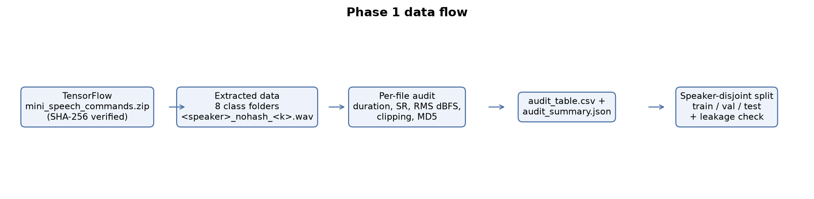

# ۴. ممیزی کیفیت داده

تمام آستانه‌ها در `configs/config.yaml` پیش از مدل‌سازی ثبت شده‌اند.

| مورد | اندازه‌گیری | تصمیم اولیه |
|---|---|---|
| فایل ناخوانا/خراب | {{n_unreadable}} فایل | در صورت وجود، فهرست در `tables/unreadable_files.csv`؛ حذف از همه‌ی splitها |
| مقادیر گمشده (جدول ممیزی) | {{n_missing_values_total}} | امپیوتیشن لازم نیست؛ در صورت وجود بررسی منشأ |
| ناسازگاری نوع/فرمت | نرخ نمونه‌برداری، کانال و subtype در بخش ۳ | یکنواخت‌سازی به ۱۶ کیلوهرتز mono در فاز ۲ فقط در صورت ناهمگنی |
| رکورد تکراری (شکل موج یکسان) | {{n_duplicate_groups}} گروه ({{n_files_in_duplicate_groups}} فایل)؛ بین کلاس‌های مختلف: {{n_duplicate_groups_across_classes}} | تکراری هم‌کلاس: فقط یکی نگه داشته می‌شود؛ تکراری بین‌کلاسی تعارض برچسب است و حذف می‌شود |
| طول کمتر از ۱ ثانیه | {{n_shorter_than_1s}} فایل؛ دقیقاً ۱ ثانیه: {{n_exactly_1s}}؛ بلندتر: {{n_longer_than_1s}} | zero-padding به انتها تا ۱۶۰۰۰ نمونه؛ برش در صورت بلندتر بودن (فاز ۲) |
| طول بسیار کوتاه (کمتر از ۰٫۵ ثانیه) | {{n_very_short}} فایل؛ طول صفر: {{n_zero_length}} | نگه داشته می‌شود و در تحلیل زیرگروه گزارش می‌شود؛ طول صفر حذف می‌شود |
| سکوت دیجیتال (peak = 0) | {{n_digital_silence}} فایل | حذف از همه‌ی splitها |
| انرژی کم (RMS < {{low_energy_threshold_dbfs}} dBFS؛ آستانه‌ی توصیفی) | {{n_low_energy}} فایل؛ جاروب آستانه: {{low_energy_sweep|dict}}؛ میانه‌ی Frame_Dyn_dB: کم‌انرژی‌ها {{frame_dyn_db_median_low_energy}} در برابر بقیه {{frame_dyn_db_median_other}} | پرچم `Low_Energy`؛ بدون تغییر برچسب؛ حذف فقط طبق قاعده‌ی پیش‌ثبت‌شده‌ی آزمون شنیدن کور (پایین) |
| کلیپینگ | {{n_files_with_any_clipping}} فایل با حداقل یک نمونه‌ی clip؛ {{n_clipped_files}} فایل با بیش از ۱٪ نمونه‌ی clip | نگه داشته می‌شود (اعوجاج واقعی ضبط)؛ در تحلیل زیرگروه گزارش می‌شود |
| نمونه‌های پرت (Tukey، ۱٫۵×IQR) | RMS: {{tukey_outliers.RMS_dBFS.n_low}} پایین و {{tukey_outliers.RMS_dBFS.n_high}} بالا؛ طول: {{tukey_outliers.Duration_sec.n_low}} پایین | پرت‌بودن آماری به‌تنهایی دلیل حذف نیست |
| جمع‌بندی حذف‌ها | {{n_excluded}} فایل؛ دلایل: {{exclude_reason_counts|dict}} | اعمال یکسان روی همه‌ی splitها پس از split؛ تخصیص گویندگان تغییر نمی‌کند |

**فایل‌های کم‌انرژی.** نسخه‌ی اولیه‌ی تحلیل آستانه را از صدک ۱٪ کمترین دامنه می‌گرفت؛ چنین آستانه‌ای *بدون توجه به داده* همیشه دقیقاً ۱٪ فایل‌ها را پرچم می‌زند و دلیل علمی ندارد. در این نسخه، RMS بر حسب dBFS فقط یک پرچم **توصیفی** (`Low_Energy`) است و تصمیم حذف با یک **آزمون شنیدن کور** با قاعده‌ی پیش‌ثبت‌شده گرفته می‌شود. این فایل‌ها در پوشه‌ی کلمه‌ی خود هستند و **خطای برچسب یا «کلاس سکوت» تلقی نمی‌شوند**: ممکن است گوینده با بهره‌ی بسیار کم یا میکروفون ضعیف ضبط کرده باشد. ساختن کلاس «سکوت» از آن‌ها نادرست است، چون همچنان برچسب کلمه دارند و نمی‌توانند نماینده‌ی ورودی «بدون گفتار» باشند.

**شاخص عینی مکمل.** برای تفکیک «گفتار ضعیف» از «فقط نویز/هیس»، پویایی فریمی (`Frame_Dyn_dB` = صدک ۹۵ منهای صدک ۱۰ سطح RMS فریم‌های ۲۵ms، با کف ‎−۱۰۰ dBFS) محاسبه شد: گفتار بین هجاها و مکث‌ها پویایی زیاد دارد و نویز ایستا ندارد. میانه‌ی آن برای فایل‌های کم‌انرژی {{frame_dyn_db_median_low_energy}} dB در برابر {{frame_dyn_db_median_other}} dB برای بقیه است (شکل ۱۱). این شاخص فقط توصیفی است و در قاعده‌ی تصمیم نقشی ندارد.

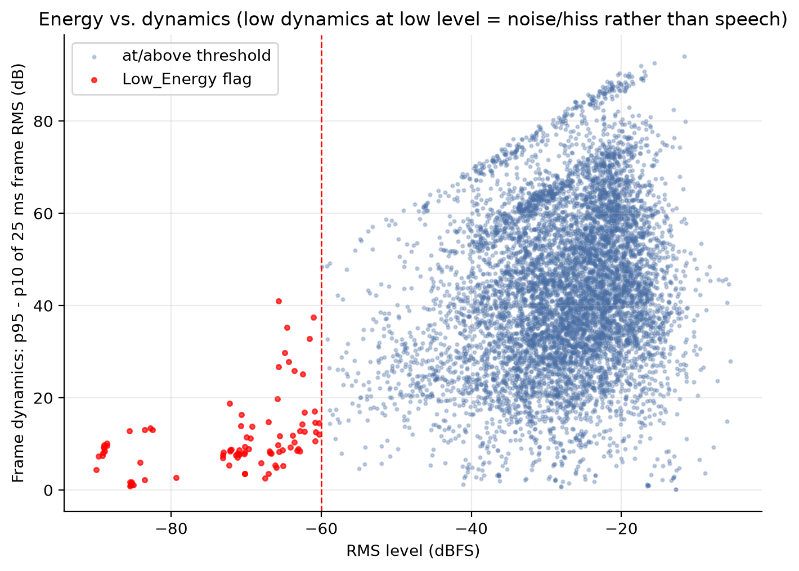

**پروتکل شنیدن کور (پیش از شنیدن در `configs/config.yaml` ثبت شد).** (۱) کلیپ‌ها بر اساس RMS در شش بازه‌ی <−۷۰، −۷۰..−۶۰، −۶۰..−۵۰، −۵۰..−۴۰، −۴۰..−۳۰ و ≥ −۳۰ dBFS دسته‌بندی شدند؛ بازه‌ی آخر (سطح عادی) **کنترل** است. (۲) از هر بازه حداکثر ۶ کلیپ با seed ثابت ۴۲ انتخاب شد. (۳) همه‌ی کلیپ‌ها peak-normalize (۰٫۷)، با نام بی‌معنا (`clip_001` و ...) و به ترتیب تصادفی ارائه شدند؛ شنونده نه برچسب را می‌دید و نه سطح انرژی را. (۴) برای هر کلیپ یکی از ۸ کلمه یا «؟» (قابل‌تشخیص نیست) ثبت شد. (۵) کلیپ *غیرقابل‌استفاده* است اگر کلمه‌ی شنیده‌شده با برچسب یکی نباشد («؟» هم شامل است). (۶) **قاعده:** اگر در بازه‌ای زیر کنترل نرخ غیرقابل‌استفاده ≥ ۵۰٪ باشد، لبه‌ی بالایی بالاترین چنین بازه‌ای آستانه‌ی حذف می‌شود و همه‌ی فایل‌های با RMS کمتر از آن از train/val/test حذف می‌شوند؛ در غیر این صورت هیچ فایلی به دلیل انرژی حذف نمی‌شود. (۷) اگر نرخ غیرقابل‌استفاده‌ی کنترل از ۲۰٪ بیشتر باشد، آزمون نامعتبر است و تکرار می‌شود.

**نتیجه‌ی آزمون** ({{listening.n_listened}} کلیپ؛ نرخ نامطابقت کنترل: {{listening.control_unusable_rate|pct}}):

{{listening.table_md}}

{{listening.decision_text}}

**محدودیت‌ها.** یک شنونده (خودم)؛ حدود ۶ کلیپ در هر بازه، یعنی توان آماری کم و فاصله‌های اطمینان پهن؛ و قابل‌فهم‌بودن برای انسان دقیقاً با قابل‌استفاده‌بودن برای مدل یکی نیست. به همین دلیل در فاز ۴ تحلیل حساسیت (با/بدون این فایل‌ها) انجام می‌شود. حذف‌ها پس از split و فقط با حذف ردیف اعمال می‌شوند، پس تخصیص گویندگان به splitها تغییر نمی‌کند.

**کم‌انرژی بودن بیشتر ویژگی «ضبط/گوینده» است.** {{n_low_energy}} فایل کم‌انرژی فقط از {{low_energy_n_speakers}} گوینده آمده‌اند و چهار گوینده‌ی اول به‌تنهایی {{low_energy_top4_speakers_files}} فایل ({{low_energy_top4_speakers_share|pct}}) را دارند. انحراف معیار میانگین RMS بین گویندگان (دست‌کم ۵ کلیپ) {{rms_between_speaker_sd_db}} dB در برابر {{rms_overall_sd_db}} dB برای کل فایل‌هاست؛ یعنی بخش بزرگی از تغییرات بلندی صدا تفاوت بین گویندگان/ضبط‌هاست. به تفکیک split، فایل‌های کم‌انرژی چنین‌اند: {{split.low_energy_per_split|dict}}، و میانه‌ی RMS هر split: {{split.median_rms_dbfs_per_split|dict}}. به همین دلیل حذف این فایل‌ها عملاً حذف ضبط‌های چند گوینده‌ی مشخص است و باید در تحلیل حساسیت فاز ۴ جدا بررسی شود (خطر ۷ در بخش ۸).

# ۵. تحلیل اکتشافی تک‌متغیره

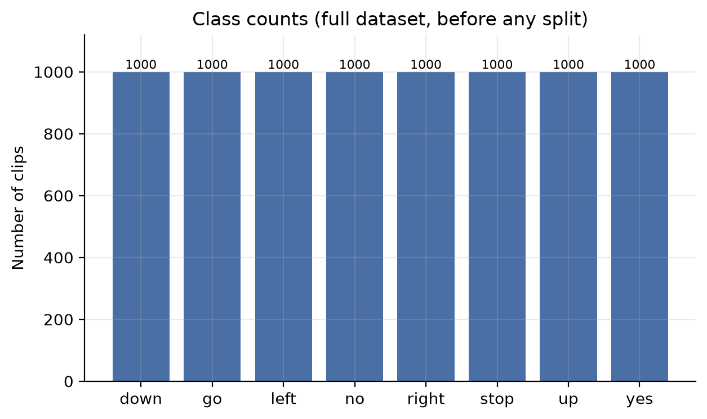

**توازن کلاس‌ها:** {{files_per_class|dict}}. این توازن حاصل ساخت زیرمجموعه است و ویژگی طبیعی گفتار نیست؛ پس از speaker-disjoint split نسبت‌ها اندکی تغییر می‌کنند (بخش ۸).

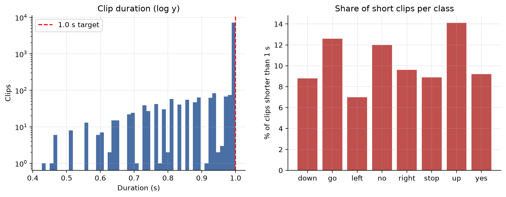

**طول:** میانگین {{duration.mean}} ثانیه، میانه {{duration.50%}}، کمینه {{duration.min}}، بیشینه {{duration.max}}، انحراف معیار {{duration.std}}. توزیع شدیداً چوله به‌سمت ۱ ثانیه است (سقف طول ضبط)، و {{n_shorter_than_1s}} کلیپ کوتاه‌ترند.

**خلاصه‌ی آماری متغیرهای پیوسته** (کل ۸۰۰۰ فایل؛ چولگی و کشیدگی‌ِ اضافی با تعریف pandas):

{{univariate_md}}

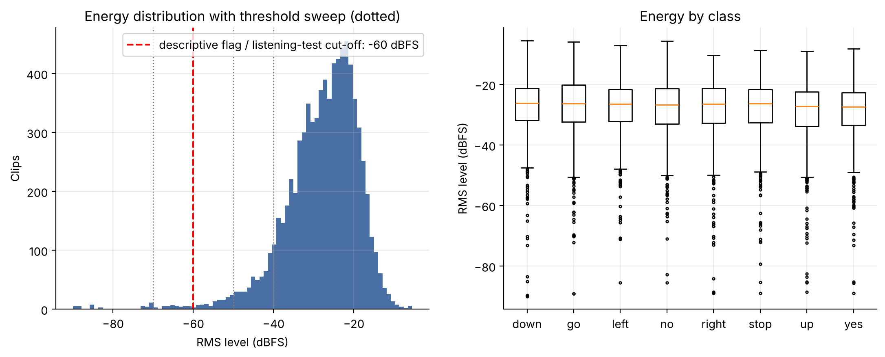

**انرژی (RMS بر حسب dBFS):** میانگین {{rms_dbfs.mean}}، میانه {{rms_dbfs.50%}}، کمینه {{rms_dbfs.min}}، بیشینه {{rms_dbfs.max}}. توزیع در شکل ۴ (چپ) یک قله‌ی اصلی در حدود ‎−۲۵ تا ‎−۲۰ dBFS و چولگی منفی دارد (چولگی در جدول بالا)؛ دم چپ بلند و پیوسته تا حدود ‎−۵۰ است و فایل‌های بسیار کم‌انرژی (حدود ‎−۹۰ تا ‎−۷۰) به‌صورت خوشه‌های کوچک جدا از بدنه دیده می‌شوند. چون دم چپ مرز طبیعی ندارد، هیچ آستانه‌ی «آشکار» از روی هیستوگرام به‌دست نمی‌آید و تصمیم حذف با آزمون شنیدن (بخش ۴) گرفته شد. میانه‌ی RMS در هشت کلاس تقریباً یکسان است (جدول بخش ۶) و جعبه‌نمودارها (شکل ۴، راست) پرت‌های پایین‌رو در همه‌ی کلاس‌ها نشان می‌دهند؛ یعنی کم‌انرژی بودن به یک کلاس خاص محدود نیست. خط‌چین قرمز، آستانه‌ی توصیفی و برش آزمون شنیدن (‎−۶۰ dBFS) است.

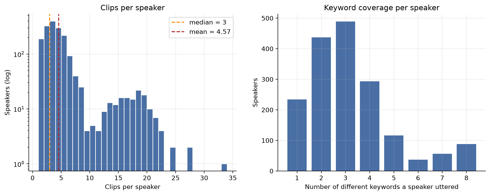

**گویندگان:** {{n_speakers}} گوینده؛ کلیپ به ازای هر گوینده: کمینه {{files_per_speaker.min}}، میانه {{files_per_speaker.50%}}، میانگین {{files_per_speaker.mean}}، بیشینه {{files_per_speaker.max}}. تعداد گویندگان با فقط یک کلیپ: {{n_speakers_with_1_file}}. پنج گوینده‌ی پرکار {{top5_speaker_share_of_files|pct}} کل کلیپ‌ها را می‌سازند؛ توزیع بسیار نامتوازن است و در بخش ۸ پیامد آن (اندازه‌ی split بر حسب گوینده) بحث می‌شود.

# ۶. تحلیل اکتشافی چندمتغیره

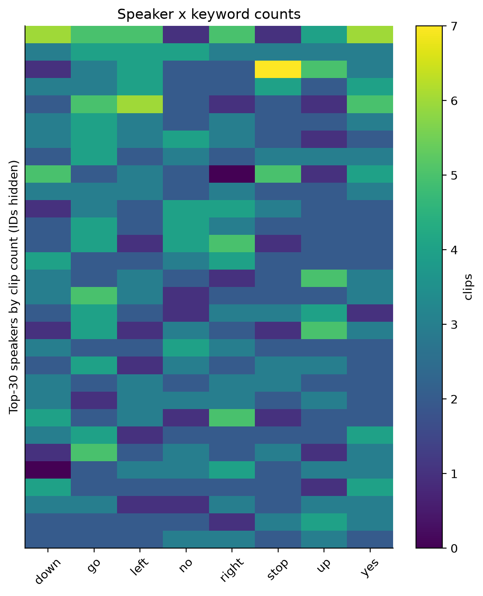

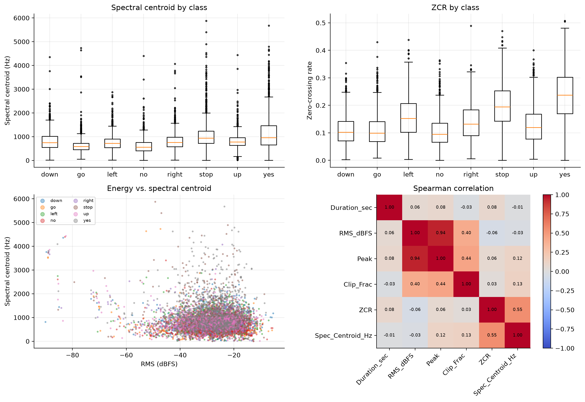

- **گوینده × کلمه:** {{frac_speakers_in_ge2_classes|pct}} گویندگان حداقل دو کلیدواژه‌ی متفاوت گفته‌اند و {{n_speakers_in_all_classes}} گوینده هر ۸ کلمه را؛ {{speakers_repeating_same_word}} گوینده یک کلمه‌ی واحد را بیش از یک بار گفته‌اند. یعنی کلیپ‌های یک گوینده مستقل نیستند.
- **مرکز طیفی و ZCR بر حسب کلاس:** بالاترین ZCR و مرکز طیفی مربوط به yes و stop است (هر دو دارای /s/)، و پایین‌ترین مربوط به no و go؛ ارقام در جدول زیر. با این حال پراکندگی داخل کلاس بزرگ است و بازه‌ی بین‌چارکی کلاس‌ها همپوشانی دارد (شکل ۷). سهم واریانس بین‌کلاسی (η²) برای ZCR برابر {{eta_squared_by_class.ZCR|pct}} و برای مرکز طیفی {{eta_squared_by_class.Spec_Centroid_Hz|pct}} است: این ویژگی‌ها اطلاعات کلاس را دارند ولی به‌تنهایی کافی نیستند.

{{per_class_md}}

- **انرژی در برابر مرکز طیفی:** در نمودار پراکنش شکل ۷ ابر نقاط متراکم است و رابطه‌ی خطی قوی دیده نمی‌شود (Spearman ماتریس همبستگی شکل ۷: RMS با مرکز طیفی تقریباً صفر)؛ فایل‌های بسیار کم‌انرژی (کمتر از ‎−۷۰) در سمت چپ با مرکز طیفی بالا و پراکنده جدا می‌افتند، که با ماهیت نویزی آن‌ها سازگار است (شکل ۱۱). همبستگی ZCR با مرکز طیفی بالاست (حدود ۰٫۵۵) که طبیعی است، چون هر دو با انرژی فرکانس بالا بالا می‌روند؛ پس این دو ویژگی افزونگی دارند. دو متغیر طول و RMS تقریباً هیچ اطلاعاتی درباره‌ی کلاس ندارند (η² برابر {{eta_squared_by_class.Duration_sec|pct}} و {{eta_squared_by_class.RMS_dBFS|pct}})، بنابراین خطر میان‌بر «طول یا بلندی صدا» در این داده ناچیز است.
- **میان‌بر ابرداده‌ای:** اگر طول یا سطح انرژی بر حسب کلاس تفاوت قابل‌ملاحظه‌ای داشته باشد، مدل می‌تواند بدون یادگیری آوا طبقه‌بندی کند؛ این با یک baseline فقط-ابرداده در فاز ۳ سنجیده می‌شود.

# ۷. تحلیل اکتشافی صوتی

برای هر کلاس ۳ کلیپ تصادفی (seed = 42، کلیپ‌های کم‌انرژی از نمونه‌گیری خارج) با موج زمانی و log-mel رسم شد (`fig08_examples_<word>.png`). پارامترهای طیف‌نگار: `n_fft=400` (۲۵ms)، `hop=160` (۱۰ms)، ۶۴ باند mel، `fmax=8000`. مقیاس dB در این شکل‌ها برای هر کلیپ نسبت به بیشینه‌ی همان کلیپ نرمال شده؛ بنابراین تراز مطلق انرژی بین کلیپ‌ها قابل‌مقایسه نیست. برای مقایسه‌ی بین کلاس‌ها، میانگین log-mel ۱۰۰ کلیپ تصادفی هر کلاس (پس از zero-padding به ۱ ثانیه و با مقیاس مشترک) در شکل ۹ آمده است. ناحیه‌ی خاکستری با خط‌چین قرمز، انتهای کلیپ‌های کوتاه‌تر از ۱ ثانیه (نیاز به padding) را نشان می‌دهد.

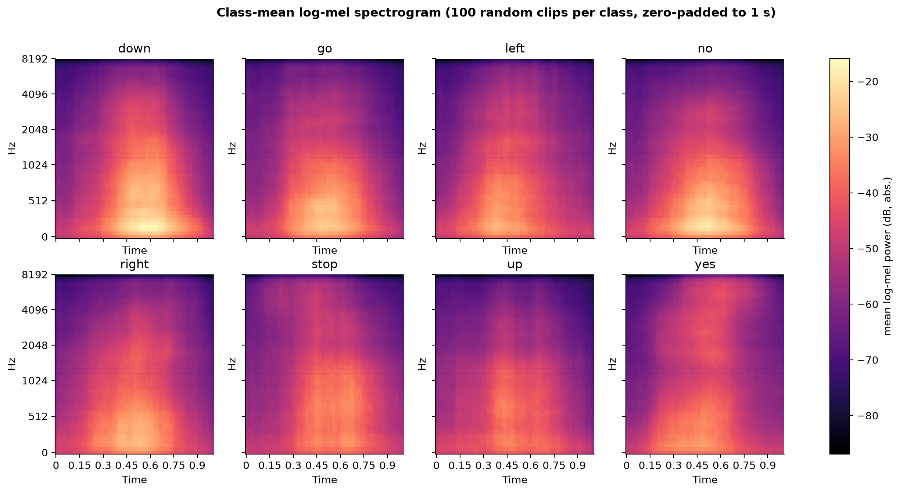

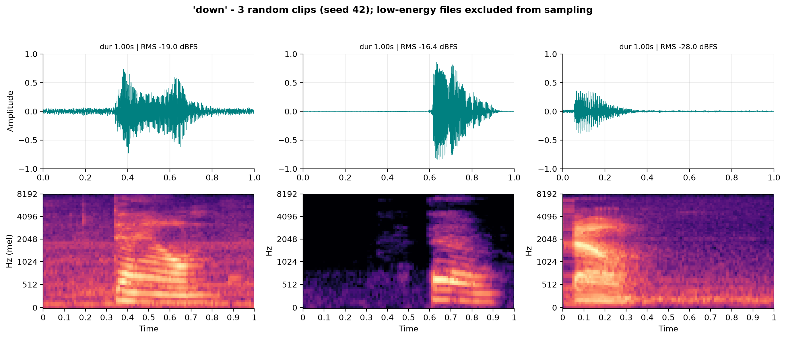

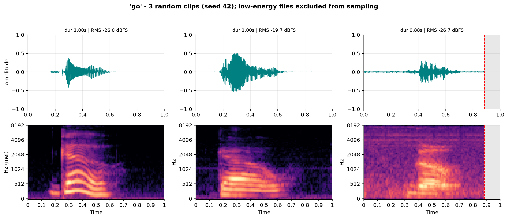

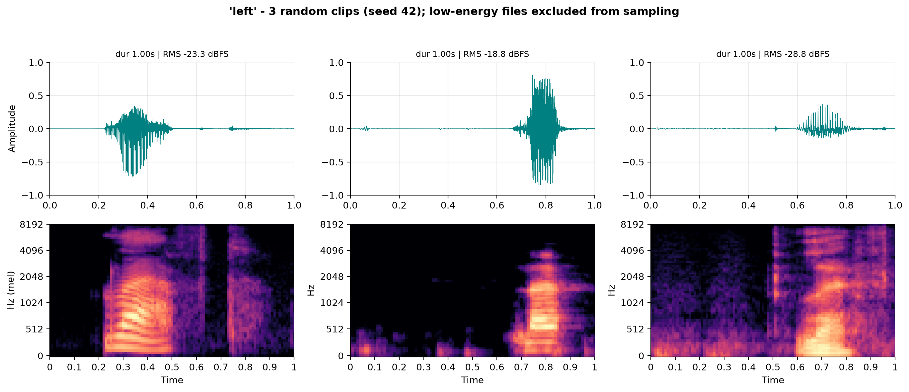

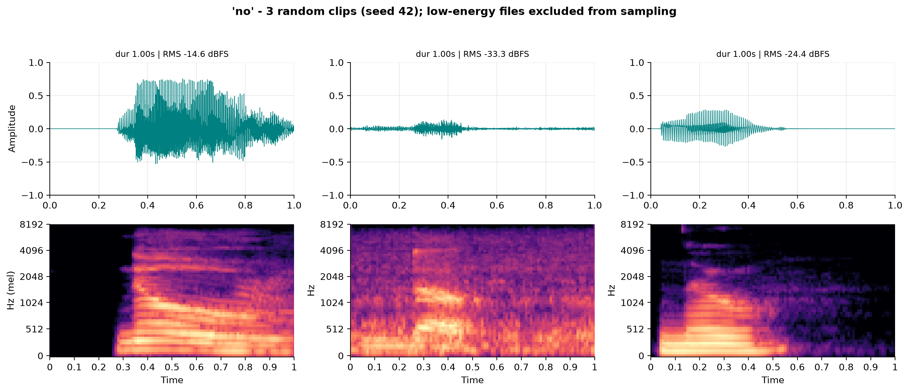

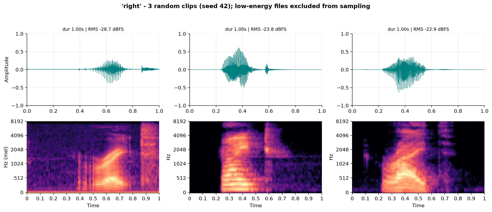

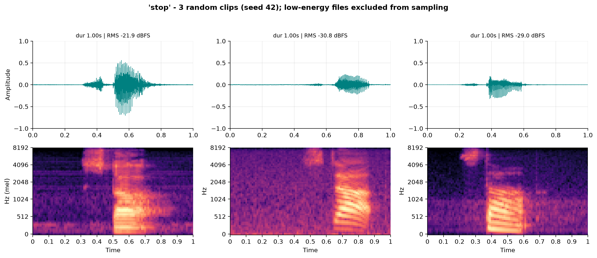

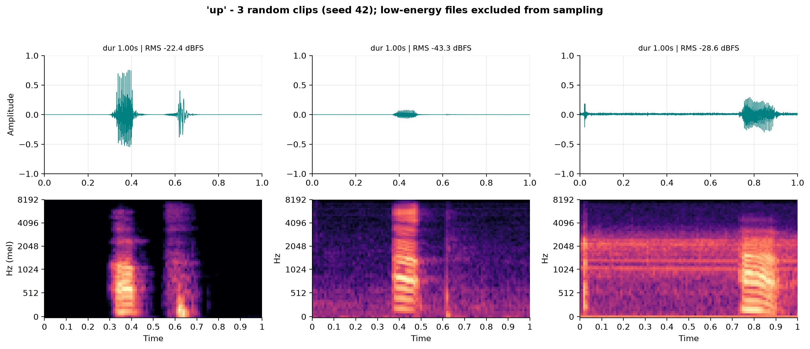

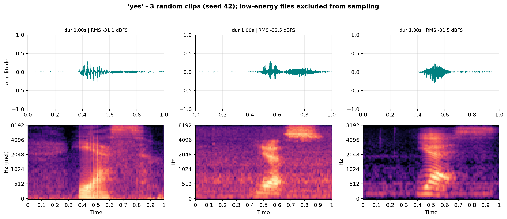

**مشاهدات** (در نمونه‌های رسم‌شده؛ تعمیم قطعی به همه‌ی داده نیست):

- **stop:** در هر سه نمونه یک رویداد کوتاه و ضعیف‌تر با انرژی در حدود ۴ تا ۸ کیلوهرتز پیش از بخش واکه‌ای اصلی دیده می‌شود (هم‌خوان آغازین). یک انفجار پایانی مجزا (/p/) در این سه نمونه به‌روشنی تفکیک نمی‌شود؛ پس ادعای «دو رویداد در ابتدا و انتها» را با این نمونه‌ها تأیید نمی‌کنیم.
- **go و no:** در بخش واکه‌ای، باندهای افقی هارمونیک در فرکانس‌های پایین (زیر حدود ۲ کیلوهرتز) دیده می‌شود؛ در go هر سه نمونه این باندها را نشان می‌دهند و باندها به سمت پایین خم می‌شوند. در no دو نمونه از سه نمونه چنین‌اند و نمونه‌ی دوم نویزی و کم‌دامنه است.
- **yes:** در هر سه نمونه انرژی در فرکانس‌های بالا (تا حدود ۸ کیلوهرتز) در بخش میانی یا پایانی کلمه دیده می‌شود، که با /s/ سازگار است؛ این با ZCR و مرکز طیفی بالاتر yes در جدول بخش ۶ هم‌خوان است.
- **up:** رویداد گفتاری کوتاه است (تقریباً ۰٫۱ تا ۰٫۲ ثانیه) و در یک نمونه دو رویداد جدا (واکه و سپس انفجار) دیده می‌شود. در یکی از نمونه‌ها باندهای افقی ثابت در سراسر کلیپ دیده می‌شوند (نویز تونال محیط).
- **همه‌ی کلاس‌ها:** گفتار معمولاً فقط حدود ۰٫۲ تا ۰٫۵ ثانیه از پنجره‌ی ۱ ثانیه‌ای را اشغال می‌کند و محل آن بین کلیپ‌ها متفاوت است (از ابتدا تا انتهای پنجره). پس در فاز ۲ تصمیم برای padding/برش و جابه‌جایی زمانی اهمیت دارد.

این مشاهدات از ۲۴ کلیپ تصادفی به‌دست آمده‌اند و فقط توصیفی‌اند؛ برای ادعای آماری از ویژگی‌های همه‌ی ۸۰۰۰ کلیپ (جدول بخش ۶) استفاده می‌شود.

**فایل‌های ناهنجار:** شکل ۱۰ کم‌انرژی‌ترین و پرکلیپ‌ترین فایل‌ها را نشان می‌دهد (محور دامنه‌ی ردیف اول عمداً بزرگ‌نمایی شده). در ردیف اول (کم‌انرژی‌ترین‌ها) شکل موج در مقیاس عادی تقریباً خط صاف است (دامنه‌ی حدود ۰٫۰۰۰۲ یعنی چند سطح کوانتیزاسیون ۱۶ بیتی) و طیف‌نگار بافت نویزی با چند رویداد باریک‌باند دیده می‌شود؛ از روی شکل نمی‌توان گفت گفتاری وجود دارد یا نه، و این دقیقاً دلیل آزمون شنیدن است (در بازه‌ی کمتر از ‎−۷۰ هر ۶ کلیپ شنیده‌شده غیرقابل‌استفاده بودند). در ردیف پرکلیپ‌ترین‌ها، شکل موج در سراسر کلمه به سقف می‌چسبد ولی ساختار هارمونیک گفتار در طیف‌نگار حفظ شده است؛ یعنی گفتار هست و فقط اعوجاج دارد، و حذف این فایل‌ها لازم نیست.

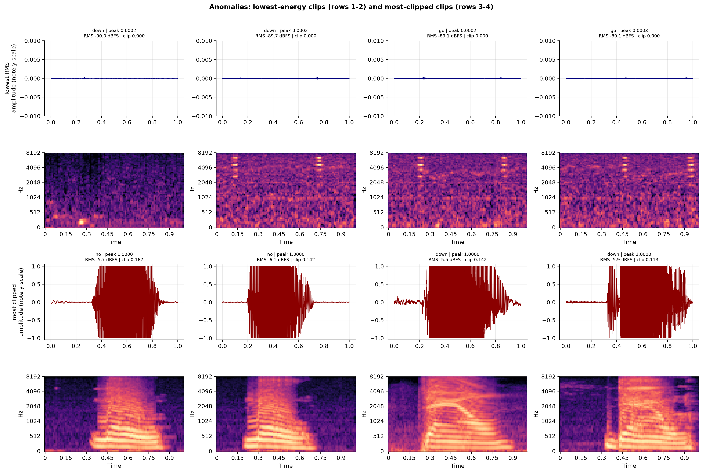

# ۸. خطر نشت اطلاعات و طراحی split

| # | خطر | سازوکار | کنترل |
|---|---|---|---|
| 1 | هویت گوینده | مدل ویژگی‌های صدای فرد (فرکانس پایه، کانال) را حفظ و به‌جای کلمه استفاده کند | split در سطح گوینده؛ تقاطع مجموعه‌ی گویندگان splitها با اسکریپت بررسی می‌شود |
| 2 | تکرار یک کلمه توسط یک گوینده (`nohash_k`) | کلیپ‌های تقریباً مشابه در train و test | همان split سطح گوینده |
| 3 | کلیپ‌های تکراری | شکل موج یکسان در دو split | MD5 شکل موج؛ تکرارها یا حذف یا هم‌split می‌شوند (کد این را assert می‌کند) |
| 4 | آمار پیش‌پردازش | mean/std نرمال‌سازی از کل داده یاد گرفته شود | فقط از train هر fold |
| 5 | augmentation و تزریق نویز | کپی‌های یک کلیپ یا نویزِ مشترک در دو split | فقط پس از split؛ augmentation آموزشی فقط روی train؛ نویز ارزیابی با seed ثابت و از ضبط‌های همان split |
| 6 | میان‌بر ابرداده‌ای | طول، میزان padding، سطح انرژی، اندیس `nohash` یا نام فایل با برچسب همبسته باشد | ورودی مدل فقط سیگنال؛ baseline فقط-ابرداده در فاز ۳ برای اندازه‌گیری |
| 7 | اثر کانال/دستگاه ضبط | مدل میکروفون/اتاق را یاد بگیرد | مشاهده‌ناپذیر؛ تا حدی با split گوینده کنترل می‌شود و به‌عنوان محدودیت ثبت می‌شود. شاهد: فایل‌های کم‌انرژی در چند گوینده متمرکزند (بخش ۴) |
| 8 | استفاده از test برای tuning | خوش‌بینی عملکرد | test قفل است؛ انتخاب مدل فقط با val |

**طرح split.** واحد split گوینده است. گویندگان با `numpy.random.default_rng(seed=42)` بُر می‌خورند و بر اساس سهم تجمعی *فایل‌ها* به train/val/test با نسبت ۸۰/۱۰/۱۰ تخصیص می‌یابند (گوینده‌ی مرزی به split قبلی می‌رود). چون split روی گوینده است، نسبت فایل‌ها تقریبی است. نتیجه‌ی اجرا:

| split | گوینده | فایل (پیش از حذف) | سهم فایل‌ها | فایل (پس از حذف) |
|---|---|---|---|---|
| train | {{split.speakers_per_split.train}} | {{split.files_per_split.train}} | {{split.file_share_per_split.train|pct}} | {{split.files_per_split_after_exclusion.train}} |
| val | {{split.speakers_per_split.val}} | {{split.files_per_split.val}} | {{split.file_share_per_split.val|pct}} | {{split.files_per_split_after_exclusion.val}} |
| test | {{split.speakers_per_split.test}} | {{split.files_per_split.test}} | {{split.file_share_per_split.test|pct}} | {{split.files_per_split_after_exclusion.test}} |

تقاطع گویندگان در هر سه جفت split برابر **صفر** است (بررسی با `verify_split`؛ آزمون واحد در `tests/test_split.py`). فهرست گویندگان هر split و فایل‌ها: `configs/splits/`. شمار کلاس‌ها در هر split در `audit_summary.json` (کلید `split.class_counts_per_split`) آمده است؛ چون split با گوینده انجام می‌شود، توازن دقیق کلاس‌ها تضمین نیست و در فاز ۳ با macro-F1 جبران می‌شود. چون لیست رسمی split در این نسخه‌ی کوچک موجود نیست، split را خودمان ساخته و اعتبارسنجی کرده‌ایم.

# ۹. خط مبنا

**Baseline ۰ (اکثریت):** پیش‌بینی همیشه کلاس پرتکرار train (`{{split.baselines_on_test.train_majority_class}}`). **Baseline ۰′ (تصادفی یکنواخت).** نتایج روی test پس از حذف‌ها ({{split.baselines_on_test.n_test_files}} کلیپ):

| baseline | accuracy | macro-F1 |
|---|---|---|
| اکثریت | {{split.baselines_on_test.majority.accuracy}} | {{split.baselines_on_test.majority.macro_f1}} |
| تصادفی یکنواخت (میانگین ۲۰۰ تکرار) | {{split.baselines_on_test.uniform_random.accuracy_mean}} | {{split.baselines_on_test.uniform_random.macro_f1_mean}} |

نکته: در داده‌ی تقریباً متوازن، baseline اکثریت accuracy نزدیک 1/K دارد ولی macro-F1 آن بسیار پایین‌تر است. اگر سهم کلاس اکثریت p و تعداد کلاس‌ها K باشد، macro-F1 = (2p/(1+p)) / K (روی کل داده: p = {{majority_accuracy_full_data|pct}}، macro-F1 = {{majority_macro_f1_full_data}}). به همین دلیل macro-F1 معیار اصلی است و accuracy به‌تنهایی کافی نیست. در فازهای بعد زنجیره‌ی مقایسه: اکثریت ← LR/SVM روی MFCC ← CNN کوچک روی log-mel.

# ۱۰. اخلاق، حریم خصوصی و حاکمیت داده

- **اطلاعات حساس:** صدا داده‌ی زیستی بالقوه شناسایی‌پذیر است. شناسه‌ی گوینده هش‌شده است و *فقط* برای طراحی split و تحلیل تعمیم استفاده می‌شود؛ هرگونه تلاش برای هویت‌یابی گوینده ممنوع است و انجام نمی‌شود. شکل‌های گزارش شناسه‌ی گوینده نشان نمی‌دهند.
- **مجوز:** مجوز و شرایط استفاده: CC BY 4.0 با الزام ذکر منبع (Warden, 2018). کارت رسمی مجموعه‌داده تصریح می‌کند داده از صدای اهداشده‌ی داوطلبان است و کاربر می‌پذیرد برای تعیین هویت گویندگان تلاش نکند؛ این پروژه چنین تلاشی نمی‌کند. داده‌ی خام در مخزن نیست. منابع و جزئیات: data/README.md.
- **سوگیری نمونه:** زبان انگلیسی، واژگان ۸ فرمان، داوطلبان ناشناس با دستگاه‌های نامشخص، و توزیع بسیار نابرابر کلیپ به ازای گوینده. چون سن/جنسیت/لهجه ثبت نشده، سوگیری نسبت به آن‌ها قابل‌اندازه‌گیری نیست؛ فقط ناهمگنی بین گویندگان و بین سطوح انرژی/نویز تحلیل می‌شود.
- **محدودیت کاربرد:** نتایج برای فارسی، گفتار پیوسته، محیط‌های واقعی خودرو/خانه و ورودی غیرکلیدواژه تعمیم داده نمی‌شوند. مدل KWS نباید برای نظارت یا شناسایی افراد به‌کار رود.

# ۱۱. محدودیت‌ها و جمع‌بندی

**آموخته‌ها:** داده‌ی ۸کلاسه‌ی متوازن و سالم از نظر قالب است؛ ریسک اصلی نشت گوینده است و با split سطح گوینده و بررسی خودکار کنترل شد؛ و فایل‌های کم‌انرژی/کلیپ‌شده و کلیپ‌های کوتاه‌تر از ۱ ثانیه باید در Phase 2 به‌صورت صریح مدیریت شوند. **عدم قطعیت:** ماهیت دقیق فایل‌های کم‌انرژی (بخش ۴؛ تمرکز آن‌ها در چند گوینده)؛ تأثیر اثر کانال/دستگاه؛ نبود Silence/Unknown. **شرط‌های کاربرد واقعی:** ارزیابی با نویز واقعی و ورودی غیرکلیدواژه پیش از هر ادعای استقرار. **گام بعد (فاز ۲):** یکنواخت‌سازی طول به ۱ ثانیه، استخراج MFCC/log-mel، کاهش بعد و خوشه‌بندی.

# ۱۲. بازتولید

```
pip install -r requirements.txt
python main.py            # دانلود، ممیزی، split، شکل‌ها و audit_summary.json
python -m pytest tests    # آزمون‌های split
python tools/build_report.py --pdf
```

seed اصلی: 42 (`configs/config.yaml`). مرجع داده و نسخه: `data/README.md`.
