**درس تحلیل داده، پاییز ۱۴۰۵** — فاطمه محرابی، شماره‌ی دانشجویی ۴۰۳۱۰۰۵۸۱
**مخزن:** https://github.com/frankiesteardrop/Data-Analysis-Project — **تگ:** `phase-2`

> اعداد جدول‌ها و متن این گزارش به‌صورت خودکار از `reports/phase2/phase2_summary.json` و فایل‌های `reports/phase2/tables/*.csv` (خروجی `python main_phase2.py`) درج شده‌اند؛ شکل‌ها در `figures/phase2/` با همان اجرا ساخته می‌شوند. توصیف‌های کیفی شکل‌ها دستی‌اند و باید با شکل‌های اجرای خودتان تطبیق داده شوند. **مجموعه‌ی test در کل این فاز خوانده نشده است** (کد آن را فقط با `--include-test` باز می‌کند و هیچ تحلیلی از آن استفاده نمی‌کند).

# ۱. خلاصه و پرسش‌های فاز ۲

فاز ۲ سه کار می‌کند: (۱) زنجیره‌ی قابل اجرای مجدد آماده‌سازی؛ (۲) ساخت ویژگی (MFCC، log-mel و ۱۶ ویژگی مهندسی‌شده با منطق صوتی)؛ (۳) کاهش بعد و خوشه‌بندی برای دیدن اینکه *ساختار فضای ویژگی را چه چیزی تعیین می‌کند*. پرسش تشخیصی از `PROJECT_CARD.md` بخش ۱۲: آیا ساختار را **کلمه** تعیین می‌کند یا **گوینده/کانال/بلندی صدا**؟ این پرسش به سؤال اصلی (Q1، استحکام در برابر نویز تحت split مستقل از گوینده) وصل است، چون اگر ویژگی‌های ساده بیشتر گوینده و کانال را کد کنند، هم نیاز به split مستقل از گوینده و هم ضعف مدل‌های کلاسیک در نویز قابل پیش‌بینی است.

**یافته‌ی اصلی (همه از train، ۷۰۸۸ کلیپ شامل val برای انتقال):**

- در فضای MFCC (۵۲ ویژگی) سه مؤلفه‌ی اول PCA عمدتاً **گوینده** را کد می‌کنند: η² گوینده برای PC1 برابر {{pc_eta2.eta2_speaker.0}}، در حالی‌که سطح تصادفی ≈ {{pc_eta2.eta2_speaker_shuffled.0}} است؛ η² کلمه برای PC1 فقط {{pc_eta2.eta2_word.0}}. بیشترین سهم کلمه در PC{{pc_summary.max_eta2_word_pc}} است ({{pc_summary.max_eta2_word}}) که فقط ≈۴٪ واریانس را توضیح می‌دهد.
- ۱۰ همسایه‌ی نزدیک هر کلیپ فقط {{knn_primary.word_purity|pct}} هم‌کلمه‌اند (تصادفی: {{knn_primary.word_chance|pct}})؛ اما در میان همسایه‌های هم‌کلمه، هم‌گوینده‌بودن **{{knn_primary.spk_enrichment}} برابر** حد تصادفی است.
- k-means با k=۸ فقط NMI برابر {{clusters_k8.nmi_word}} با کلمه دارد (حد تصادفی {{clusters_k8.nmi_word_chance}}). k انتخاب‌شده با silhouette برابر **{{k_selection.k_selected}}** است و پایدار است، اما NMI آن با کلمه {{clusters_k2.nmi_word}} است: یعنی پایدارترین الگو **کلمه نیست**.
- نویز افزودنی ساختار را به‌شدت جابه‌جا می‌کند: در ۰ dB نویز سفید/صورتی NMI خوشه‌ها با کلمه به {{noise.nmi_word_k8_at_0db.white}} می‌رسد و NMI «نوع نویز» با خوشه‌ها در SNRهای ۵ و ۰ برابر {{noise.nmi_noise_type_vs_cluster_k8_low_snr}} است.

# ۲. زنجیره‌ی آماده‌سازی (قابل اجرای مجدد)

همه‌ی پارامترها در `configs/config.yaml` زیر کلید `phase2` هستند و **پیش از اولین اجرای فاز ۲ ثابت شده‌اند** (commit جداگانه‌ی «freeze config»). اجرا: `python main_phase2.py`.

| گام | تصمیم | کد |
|---|---|---|
| ورودی | manifest فاز ۱ (`configs/splits/split_manifest.csv`)؛ فقط train و val؛ ۱۱۵ فایل حذف‌شده‌ی فاز ۱ (۸۹ کم‌انرژی با آزمون شنیدن کور + ۲۷ تکراری هم‌کلاس) **بازیابی یا impute نمی‌شوند** | `src/preprocess.py: load_manifest` |
| قالب | mono، نرخ نمونه‌برداری ۱۶ kHz (همه‌ی فایل‌ها از قبل ۱۶ kHz‌اند؛ resample فقط در صورت لزوم)، float32 | `read_clip` |
| طول | هدف ۱ ثانیه = ۱۶۰۰۰ نمونه. **کوتاه‌تر: صفر در انتها (padding)؛ بلندتر: نگه‌داشتن ۱ ثانیه‌ی اول (crop)**. طول واقعی (`n_valid`) ذخیره می‌شود | `fix_length` |
| دامنه | **هیچ نرمال‌سازی دامنه‌ای روی سیگنال انجام نمی‌شود**؛ بلندی صدا یک عامل مزاحم است که می‌خواهیم در تحلیل ببینیم (حساسیت: نسخه‌ی بدون c0) | — |
| آمار آموخته‌شده | `StandardScaler` و PCA و UMAP و k-means فقط روی **train** برازش می‌شوند؛ val فقط transform/assign می‌شود | `src/discovery.py: Space` |

**اجرای واقعی روی داده:** train: {{preprocessing.train.n_clips}} کلیپ، {{preprocessing.train.n_padded}} کلیپ ({{preprocessing.train.frac_padded|pct}}) padding دارد و {{preprocessing.train.n_cropped}} کلیپ crop شده است؛ کوتاه‌ترین کلیپ {{preprocessing.train.valid_sec_min}} ثانیه است و میانه‌ی padding روی کلیپ‌های padded‌شده {{preprocessing.train.median_pad_samples}} نمونه. val: {{preprocessing.val.n_clips}} کلیپ، {{preprocessing.val.n_padded}} padded ({{preprocessing.val.frac_padded|pct}}).

**داده‌ی گمشده.** این مجموعه سلول NaN ندارد و گمشدگی به سه شکل است: (الف) فایل کوتاه → padding که با محاسبه‌ی ویژگی فقط روی فریم‌های معتبر خنثی می‌شود (آزمون `test_features_finite_shapes_and_padding_invariance` نشان می‌دهد افزودن padding MFCC را تغییر نمی‌دهد)؛ (ب) فایل ناخوانا: صفر مورد (فاز ۱)؛ (ج) فایل تقریباً بی‌صدا → حذف، نه impute، چون جایگزین‌کردن ورودی بی‌صدا برچسب کلمه را معنادار نمی‌کند. در ویژگی‌ها: NaN در MFCC/مهندسی‌شده train = {{missing.train_nan_mfcc}}/{{missing.train_nan_eng}}، val = {{missing.val_nan_mfcc}}/{{missing.val_nan_eng}}. تنها NaN مربوط به تخمین f0 است ({{missing.train_nan_f0}} کلیپ train، {{missing.val_nan_f0}} کلیپ val) که فقط یک **متغیر تشخیصی** (نه ورودی) است و با میانه‌ی train ({{missing.f0_impute_value_hz}} Hz) پر می‌شود.

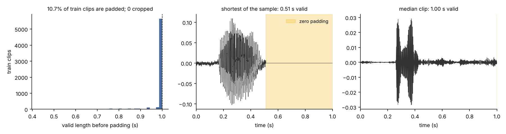

*شکل ۱ — چپ: توزیع طول واقعی کلیپ‌ها؛ وسط و راست: یک کلیپ کوتاه و یک کلیپ میانه با ناحیه‌ی padding.*

# ۳. مهندسی ویژگی

**پارامترهای طیفی (مطابق الزام مسیر د):** پنجره‌ی ۴۰۰ نمونه (۲۵ ms، Hann)، گام ۱۶۰ نمونه (۱۰ ms)، `n_fft=400`. **MFCC:** ۴۰ باند mel (۰–۸ kHz) → DCT → ۱۳ ضریب؛ مشتق (delta، پنجره‌ی ۹). **log-mel:** ۶۴ باند mel، ۰–۸ kHz، به dB، شکل ۶۴×۱۰۱ برای CNN فاز ۳ (ذخیره در `data/features/`، commit نمی‌شود).

**مجموعه‌ی اصلی (ثبت‌شده در کارت پروژه §۱۲):** میانگین و انحراف معیار هر یک از ۱۳ ضریب و ۱۳ مشتق روی فریم‌های معتبر → **۵۲ ویژگی**.

**ویژگی‌های مهندسی‌شده (۱۶ مورد، پیش از دیدن test و پیش از هر خوشه‌بندی تعریف شدند؛ `src/features.py: ENGINEERED_SPEC`).** ستون‌های η² سهم واریانس هر ویژگی را که کلمه یا گوینده توضیح می‌دهد نشان می‌دهند (گوینده‌هایی با ≥۸ کلیپ؛ سطح تصادفی η² گوینده ≈ {{engineered.mean_eta2_speaker_shuffled}}):

{{@engineered_features.csv|feature,logic,eta2_word,eta2_speaker,rho_rms}}

**افزونگی:** قاعده‌ی ثبت‌شده: جفت‌هایی با |ρ اسپیرمن| ≥ ۰٫۹۵ افزونه گزارش می‌شوند. نتیجه: {{engineered.redundant_pairs}} (centroid_mean و rolloff_mean؛ هر دو نگه داشته شدند چون مرز دقیقاً روی آستانه است و حذفشان نتیجه را عوض نمی‌کند؛ فاز ۳ با رگولاریزاسیون سروکار دارد).

**یافته‌ی مهم درباره‌ی خود ویژگی‌ها.** میانگین η² کلمه روی ۱۶ ویژگی {{engineered.mean_eta2_word}} و میانگین η² گوینده {{engineered.mean_eta2_speaker}} است. ویژگی‌هایی که بیشترین سهم کلمه را دارند: {{engineered.top3_word}}؛ و ویژگی‌های وابسته به شدت به بلندی صدا: {{engineered.top3_rms}}. چند ویژگی («frame_dyn_db»، «active_frac»، «active_dur_s»، «onset_s»، «n_energy_peaks») تقریباً هیچ اطلاعاتی درباره‌ی کلمه ندارند ولی به گوینده/شرایط ضبط وابسته‌اند؛ این‌ها **نشانگر کانال و پروتکل ضبط‌اند، نه محتوای واژه**، و در مدل‌سازی فاز ۳ باید با احتیاط (مثلاً در آزمون حذف) استفاده شوند.

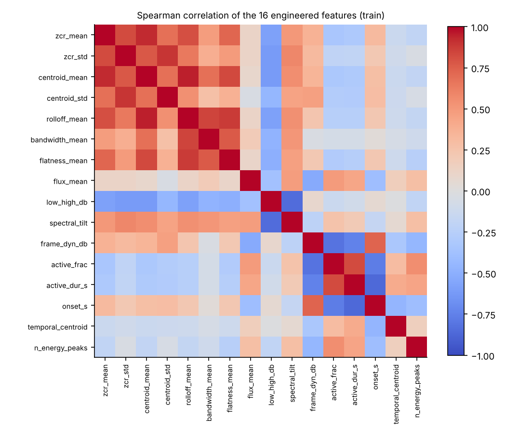

*شکل ۲ — همبستگی اسپیرمن ویژگی‌های مهندسی‌شده.*

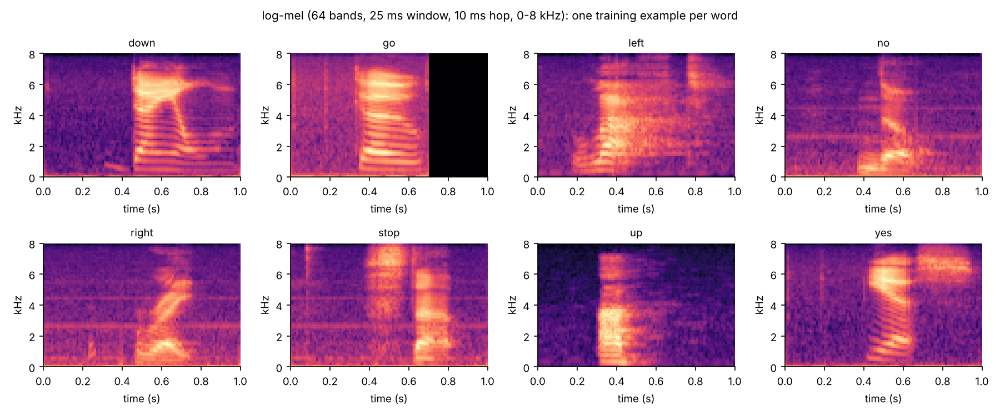

*شکل ۳ — یک نمونه از هر کلمه (log-mel).*

# ۴. Augmentation و نویز کنترل‌شده

| بخش | قاعده (ثابت‌شده در config) |
|---|---|
| gain | یکنواخت در [−۶، +۶] dB |
| time shift | یکنواخت در [−۱۰۰، +۱۰۰] ms با صفر‌پرکردن |
| نویز | با احتمال ۰٫۵؛ نوع: white / pink / babble (جمع ۶ کلیپ **هم‌split**)؛ SNR از {۵، ۱۰، ۲۰} dB |
| دامنه‌ی اعمال | **فقط train** (یک نسخه‌ی افزوده به ازای هر کلیپ)؛ تابع `assert_train_only` در صورت دیدن split دیگر خطا می‌دهد |
| نویز ارزیابی | **فقط val** (تشخیصی)، SNR ∈ {۲۰، ۱۰، ۵، ۰}، سه نوع نویز، seed ثابت |

نتیجه‌ی اجرا: {{augmentation.n_aug}} نسخه‌ی افزوده؛ {{augmentation.frac_with_noise|pct}} آن‌ها نویز دارند ({{augmentation.noise_counts|dict}})؛ gain در [{{augmentation.gain_db_min}}، {{augmentation.gain_db_max}}] dB و shift در [{{augmentation.shift_ms_min}}، {{augmentation.shift_ms_max}}] ms. **SNR اندازه‌گیری‌شده با SNR درخواستی حداکثر {{augmentation.measured_snr_abs_err_max}} dB اختلاف دارد** (آزمون واحد نیز این را تأیید می‌کند). همه‌ی intensityها در `data/features/augmentation_log.csv` و خلاصه‌ی آن در `reports/phase2/tables/augmentation_summary.csv` ثبت می‌شود.

**اثر روی فضای ویژگی.** جابه‌جایی میانه‌ی نسخه‌ی افزوده نسبت به اصلی (فاصله در PCA-۱۰): بدون نویز {{augmentation.median_displacement_by_noise.none}}، babble {{augmentation.median_displacement_by_noise.babble}}، pink {{augmentation.median_displacement_by_noise.pink}}، white {{augmentation.median_displacement_by_noise.white}}. یعنی gain و shift به‌تنهایی کم جابه‌جا می‌کنند و **نویز افزودنی (به‌ویژه سفید/صورتی) بزرگ‌ترین جابه‌جایی** را ایجاد می‌کند. این برای فاز ۳ مفید است (augmentation واقعاً توزیع را پهن می‌کند)، ولی هشدار هم هست: خوشه‌های k-means آموخته‌شده روی دادهٔ تمیز، نسخه‌ی نویزی را در خوشه‌ی دیگری می‌گذارند.

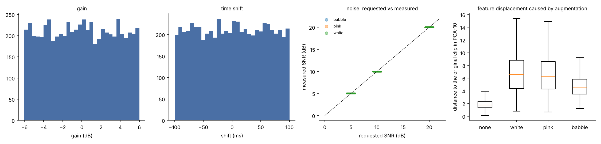

*شکل ۴ — توزیع شدت‌های augmentation، SNR درخواستی در برابر اندازه‌گیری‌شده، و جابه‌جایی در فضای ویژگی.*

# ۵. کاهش بعد: PCA و UMAP

**PCA (برازش روی train؛ ۵۲ ویژگی استانداردشده):** PC1–۵ به‌ترتیب {{pca.var_ratio_pc1_5.0}}، {{pca.var_ratio_pc1_5.1}}، {{pca.var_ratio_pc1_5.2}}، {{pca.var_ratio_pc1_5.3}}، {{pca.var_ratio_pc1_5.4}} از واریانس را توضیح می‌دهند؛ دو مؤلفه‌ی اول {{pca.cum_var_pc2}} و ده مؤلفه‌ی اول {{pca.cum_var_pc10}}؛ برای ۸۰٪ واریانس {{pca.n_pc_80}} مؤلفه لازم است. طیف ملایم یعنی اطلاعات در چند محور محدود فشرده نمی‌شود.

**چه چیزی هر مؤلفه را توضیح می‌دهد؟** (η²؛ سطح تصادفی گوینده ≈ ۰٫۰۶–۰٫۰۸)

{{@pca_eta2.csv|pc,var_explained,eta2_word,eta2_speaker,eta2_speaker_shuffled,eta2_loudness}}

PC1 تا PC3 بیشتر گوینده‌محورند، بلندی صدا فقط بخش کوچکی از PC1 را می‌سازد (بیشینه η² بلندی = {{pc_summary.max_eta2_loudness}} در PC{{pc_summary.max_eta2_loudness_pc}}) و بیشترین سهم کلمه در PC{{pc_summary.max_eta2_word_pc}} دیده می‌شود. بنابراین تفاوت «بلندی» توضیح اصلی نیست؛ **نشانه‌های ثابت هر گوینده/جلسه‌ی ضبط (کانال، میکروفون، فاصله، نویز ثابت)** توضیح اصلی‌اند. توجه: در این داده «گوینده» و «کانال/دستگاه» جدا قابل‌تفکیک نیستند (هر گوینده معمولاً با یک دستگاه ضبط شده)، پس این تحلیل نمی‌تواند بگوید کدام یک سهم دارد.

**UMAP (n_neighbors=۱۵، min_dist=۰٫۱):** درستی همسایگی (trustworthiness) در ۱۵ همسایه: PCA دوبعدی {{umap.trustworthiness_pca2}}، UMAP {{umap.trustworthiness_umap2}}. خلوص همسایگی کلمه (۱۰ همسایه): UMAP دوبعدی {{umap.knn10_word_purity_umap}}، PCA دوبعدی {{umap.knn10_word_purity_pca2}}. برای نقاط val که به فضای train منتقل شدند، خلوص همسایگی کلمه (در PCA-۱۰) {{umap.val_knn_word_purity}} است؛ یعنی ساختار ضعیف ولی واقعی کلمه به گویندگان دیده‌نشده منتقل می‌شود. k-means روی UMAP پایدار نیست (ARI بین seedهای UMAP: {{umap.seed_ari_kmeans8_on_umap}}) و NMI آن با کلمه {{umap.kmeans8_on_umap_nmi_word}} است؛ **پس خوشه‌های UMAP را نباید مدرک ساختار کلمه‌ای گرفت.**

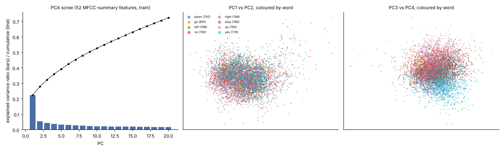

*شکل ۵ — PCA: scree و نمودار PC1/PC2 و PC3/PC4 با رنگ کلمه.*

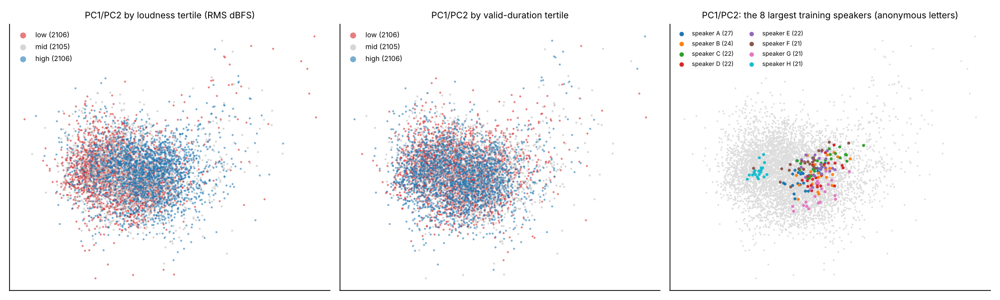

*شکل ۶ — همان فضا با رنگ بلندی صدا، طول واقعی و ۸ گوینده‌ی بزرگ‌تر (حروف بی‌نام).*

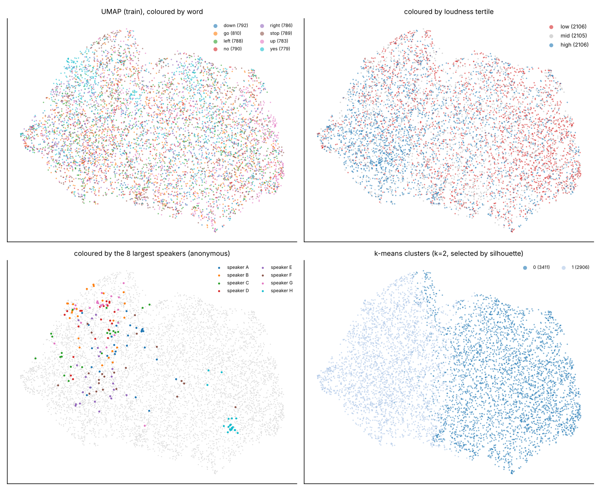

*شکل ۷ — UMAP روی train. در تصویر ما رنگ کلمه تقریباً مخلوط است و فقط یک ناحیه‌ی کم‌تراکم از «yes» (بالا-چپ) دیده می‌شود؛ بلندی صدا یک گرادیان آشکار چپ–راست می‌سازد؛ هر گوینده‌ی بزرگ‌تر (حروف) در یک ناحیه‌ی کوچک جمع می‌شود (مثلاً گوینده‌ی H پایین-راست)؛ و k=۲ فضا را تقریباً با یک خط عمودی نصف می‌کند.*

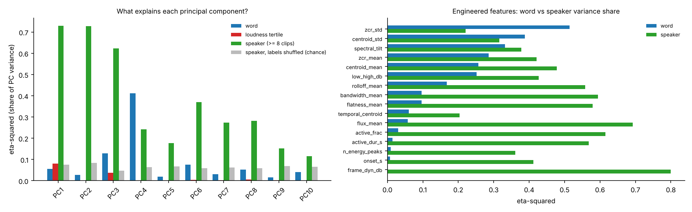

*شکل ۸ — چپ: η² هر مؤلفه‌ی PCA برای کلمه، بلندی و گوینده (به‌همراه سطح تصادفی)؛ راست: همین برای ۱۶ ویژگی مهندسی‌شده.*

# ۶. خوشه‌بندی و انتخاب پارامتر

**روش‌ها:** k-means (۱۰ شروع تصادفی) و خوشه‌بندی سلسله‌مراتبی Ward روی PCA-۱۰ استانداردشده‌ی train، k از ۲ تا ۱۶. **قاعده‌ی ثبت‌شده برای انتخاب k:** بیشینه‌ی silhouette؛ پایداری جداگانه گزارش می‌شود و الگو فقط اگر همه‌ی ARIهای پایداری ≥ {{k_selection.stable_threshold}} باشد «پایدار» نامیده می‌شود. پایداری: (الف) ۱۰ seed مختلف (ARI جفتی)؛ (ب) ۱۰ زیرنمونه‌ی ۸۰٪ (ARI نسبت به خوشه‌بندی مرجع روی کل داده)؛ (ج) تغییر مقیاس‌بندی (robust، min-max، حذف c0 که وابسته به بلندی است).

{{@k_selection.csv|k,silhouette,silhouette_ward,seed_ari,subsample_ari,scaling_ari_robust,scaling_ari_minmax,scaling_ari_no_c0,nmi_word,nmi_loudness}}

- **k انتخاب‌شده = {{k_selection.k_selected}}** (silhouette = {{k_selection.silhouette_at_k}}). پایداری آن: seed {{k_selection.stability_at_k.seed_ari}}، زیرنمونه {{k_selection.stability_at_k.subsample_ari}}، robust {{k_selection.stability_at_k.scaling_ari_robust}}، min-max {{k_selection.stability_at_k.scaling_ari_minmax}}، بدون c0 {{k_selection.stability_at_k.scaling_ari_no_c0}} — همه ≥ آستانه، پس **پایدار است**. تنها kهای پایدار: {{k_selection.k_stable}}.
- اما NMI این خوشه‌ها با کلمه فقط {{clusters_k2.nmi_word}} (حد تصادفی {{clusters_k2.nmi_word_chance}}) و با گوینده {{clusters_k2.nmi_speaker}} (حد تصادفی {{clusters_k2.nmi_speaker_chance}}) است. این «ساختار دوتایی» پایدارترین الگوست ولی **الگوی کلمه‌ای نیست**؛ با گروه‌بندی بلندی/گوینده/کانال سازگار است.
- **k=۸ (تعداد کلمات) به‌عنوان مرجع، نه انتخاب:** silhouette = {{k_selection.silhouette_at_8}}؛ پایداری: seed {{k_selection.stability_at_8.seed_ari}}، زیرنمونه {{k_selection.stability_at_8.subsample_ari}}، robust {{k_selection.stability_at_8.scaling_ari_robust}}، min-max {{k_selection.stability_at_8.scaling_ari_minmax}}، بدون c0 {{k_selection.stability_at_8.scaling_ari_no_c0}}. **ناپایدار است** (به‌ویژه نسبت به مقیاس‌بندی). خلوص کلمه در خوشه‌ها {{clusters_k8.purity_word|pct}} (حد تصادفی ۱۲٫۵٪ برای ۸ کلاس متوازن)؛ NMI با کلمه روی train {{clusters_k8.nmi_word}} و روی val (گویندگان دیده‌نشده) {{clusters_k8.nmi_word_val}}؛ ARI {{clusters_k8.ari_word}}. Ward با k=۸: NMI با کلمه {{ward8.nmi_word}}، و ARI با k-means برابر {{ward8.ari_vs_kmeans8}} (دو روش با هم توافق ضعیف دارند).

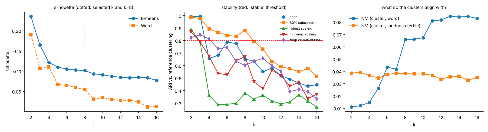

*شکل ۹ — silhouette، پایداری (seed/زیرنمونه/مقیاس‌بندی) و هم‌خوانی خوشه‌ها با کلمه و بلندی.*

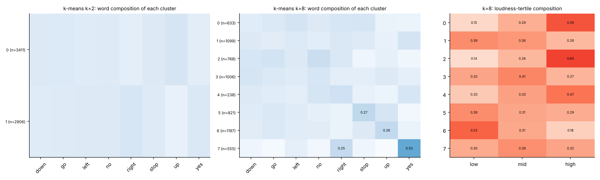

*شکل ۱۰ — ترکیب کلمه (و بلندی) در هر خوشه.*

# ۷. مقایسه‌ی مجموعه‌ی ویژگی‌ها (تحلیل حساسیت — **اکتشافی**)

این مقایسه در کارت پروژه ثبت نشده بود و پس از دیدن نتایج اولیه‌ی MFCC افزوده شد؛ بنابراین **exploratory** است و فقط برای جهت‌دهی به فاز ۳ استفاده می‌شود. همه با همان روش (استانداردسازی train-fit، PCA-۱۰، k-means با k=۸):

{{@feature_set_comparison.csv|feature_set,n_features,var_explained_pc10,knn10_word_purity,knn10_spk_enrichment,kmeans8_nmi_word_train,kmeans8_nmi_word_val,kmeans8_nmi_loudness}}

مجموعه‌ی مهندسی‌شده‌ی ۱۶تایی در k-means از MFCC خالص کمی بیشتر با کلمه هم‌خوان است، ولی **همه‌ی NMIها کوچک‌اند**. خلاصه‌ی log-mel (میانگین/انحراف معیار ۶۴ باند) تقریباً فقط بلندی را کد می‌کند (NMI با بلندی بالاتر از همه) و هم‌خوانی ضعیف‌تری با کلمه دارد. چون خلاصه‌های ایستا زمان را از بین می‌برند، **انتظار فاز ۳ این است که مدل‌های دارای بُعد زمانی (CNN روی log-mel) برتری واقعی داشته باشند**؛ این یک فرضیه است، نه یافته.

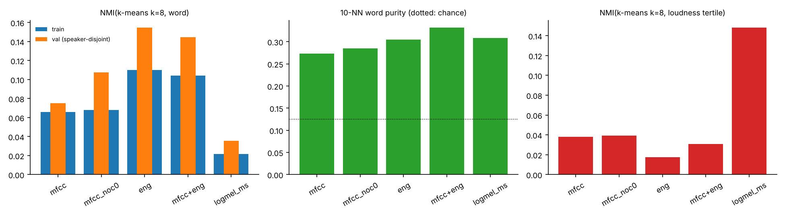

*شکل ۱۱ — مقایسه‌ی مجموعه‌ی ویژگی‌ها.*

# ۸. ساختار و نویز (val، تشخیصی)

نقاط val با ۳ نوع نویز در ۴ سطح SNR به فضای train (scaler، PCA و k-means آموخته‌شده روی train) منتقل شدند:

{{@noise_conditions.csv|condition,nmi_word_k8,knn_word_purity,centroid_shift_pc12,mean_displacement,frac_same_cluster_k8}}

- روی داده‌ی تمیز val: NMI(k=۸، کلمه) = {{noise.clean.nmi_k8}}، خلوص همسایگی کلمه = {{noise.clean.knn_word}}.
- با کاهش SNR خلوص همسایگی تقریباً یکنواخت پایین می‌آید؛ در ۰ dB: white {{noise.knn_word_at_0db.white}}، pink {{noise.knn_word_at_0db.pink}}، babble {{noise.knn_word_at_0db.babble}} (تصادفی ۰٫۱۲۵).
- نویز سفید/صورتی تقریباً **همه‌ی کلیپ‌ها را به یک گوشه‌ی فضا** می‌فرستد (در ۰ dB تنها ۱۲٫۵٪ کلیپ‌ها همان خوشه‌ی تمیز خود را حفظ می‌کنند، یعنی هم‌اندازه‌ی تصادف) و NMI خوشه‌ها با کلمه صفر می‌شود؛ babble جابه‌جایی کمتری دارد و خوشه‌بندی را بهتر حفظ می‌کند.
- در SNRهای ۵ و ۰ dB، **نوع نویز** با خوشه‌ها NMI برابر {{noise.nmi_noise_type_vs_cluster_k8_low_snr}} دارد، در حالی‌که NMI کلمه {{noise.nmi_word_vs_cluster_k8_low_snr}} است: تحت نویز زیاد، «شرایط نویز» ساختار فضا را می‌سازد، نه کلمه.

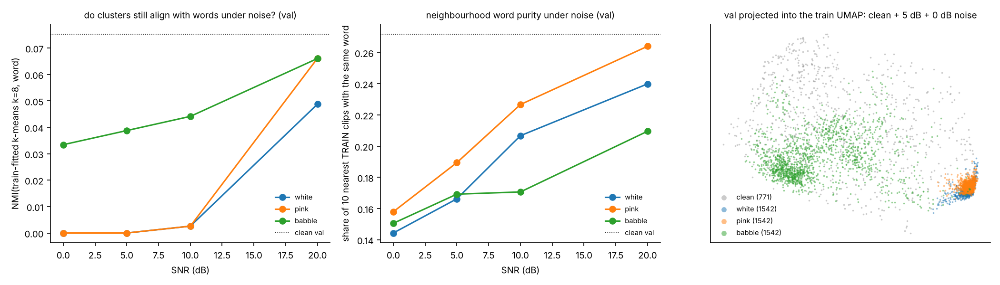

*شکل ۱۲ — چپ و وسط: هم‌خوانی خوشه‌ها و همسایگی با کلمه بر حسب SNR؛ راست: val تمیز و نویزی (۵ و ۰ dB) پروجکت‌شده روی UMAP آموزشی. نویز سفید و صورتی در یک ناحیه‌ی بسیار فشرده در راست، babble در پراکندگی بیشتر.*

# ۹. تفسیر، ارتباط با سؤال اصلی و محدودیت‌ها

**جمع‌بندی در پاسخ به پرسش بخش ۱۲ کارت:** در ویژگی‌های ایستای صوتی، ساختار غالب با **گوینده/کانال (و به شکل کوچک‌تر بلندی صدا)** تعیین می‌شود نه کلمه. کلمه سیگنال واقعی ولی ضعیف دارد (همسایگی‌ها ۲٫۲ برابر تصادف‌اند و این ضعف روی گویندگان دیده‌نشده val هم تکرار می‌شود). نتایج برای Q1 این پیامدها را دارند:

1. **Split مستقل از گوینده ضروری است** و نشت گوینده در دادهٔ ما ملموس است (غنی‌شدگی همسایه‌ی هم‌گوینده ≈ {{knn_primary.spk_enrichment}}×). یک split تصادفی کلیپ‌ها بدون شک بهتر از واقعیت به‌نظر می‌رسد (این فقط تشخیص است؛ عدد split تصادفی گزارش نمی‌شود).
2. **baseline کلاسیک با خلاصه‌ی ایستا** (MFCC mean/std + LR/SVM) انتظار می‌رود ضعیف باشد؛ فاز ۳ باید آن را صادقانه گزارش کند.
3. **نویز** ساختار ویژگی‌ها را عوض می‌کند، پس آموزش بدون augmentation احتمالاً در نویز فرو می‌ریزد؛ augmentation (فقط train) که اینجا ساخته و اعتبارسنجی شد برای Q1 لازم است.
4. در مدل‌سازی باید ویژگی‌های «پروتکل/کانال» (مثل `frame_dyn_db`، `onset_s`، `active_dur_s`) در آزمون حذف بررسی شوند.

**محدودیت‌ها و صداقت:**

- η² گوینده فقط روی {{speakers.n_speakers_ge_min}} گوینده با ≥۸ کلیپ ({{speakers.clips_in_speakers_ge_min}} کلیپ از {{speakers.n_train_speakers}} گوینده‌ی train) محاسبه شد؛ مقدار پایه‌ی تصادفی (برچسب‌های shuffle‌شده) کنارش آمده است. گوینده و کانال/دستگاه جدا قابل‌تفکیک نیستند.
- NMI ≈ ۰٫۰۷ یعنی ساختار ضعیف، نه نبود ساختار: روش‌های بدون ناظر ساده با ۸ خوشه فقط یک نگاه تشخیصی‌اند و درباره‌ی توان یک مدل نظارتی حرفی نمی‌زنند.
- شناسه‌ی گوینده فقط برای رنگ‌آمیزی/η² استفاده شد (حروف بی‌نام در شکل‌ها)، هیچ هویت‌یابی انجام نشده است.
- هیچ ادعای علّی مطرح نمی‌شود. فقط train و val استفاده شده؛ test دست‌نخورده است.
- بخش ۷ اکتشافی است و انتخاب مجموعه‌ی ویژگی در فاز ۳ فقط با val انجام می‌شود، نه test.

**انحراف از برنامه:** (۱) قاعده‌ی silhouette طبق پیش‌ثبت‌نام k=۲ داد؛ k=۸ به‌عنوان مرجع هم گزارش شد، نه جایگزین. (۲) مقایسه‌ی مجموعه‌ی ویژگی‌ها (بخش ۷) و نسخه‌ی بدون c0 پس از دیدن نتایج MFCC افزوده شدند (اکتشافی). (۳) از روش مبتنی بر چگالی (DBSCAN) استفاده نشد؛ طبق نیاز درس k-means و Ward کافی‌اند.

# ۱۰. بازتولید

```bash
pip install -r requirements.txt
python main.py                    # فاز ۱ (در صورت نبود manifest)
python main_phase2.py             # ساخت ویژگی‌ها + تحلیل + شکل‌ها (~۵ دقیقه روی ۲ هسته)
python -m pytest tests
python tools/build_report.py --phase 2 --pdf
```

| خروجی | مسیر |
|---|---|
| کد خط لوله | `src/preprocess.py`, `src/augment.py`, `src/features.py`, `src/discovery.py`, `src/phase2_figs.py`, `main_phase2.py` |
| شکل‌ها | `figures/phase2/` |
| جدول‌ها و اعداد | `reports/phase2/tables/`, `reports/phase2/phase2_summary.json` |
| فهرست ویژگی‌ها و منطق | بخش ۳ و `reports/phase2/tables/engineered_features.csv` |
| آزمون‌ها | `tests/test_phase2.py` (آزمون SNR، train-only بودن، fit فقط روی train، عدم تأثیر padding، قطعی‌بودن) |
| ویژگی‌های ذخیره‌شده (commit نمی‌شوند) | `data/features/` |
